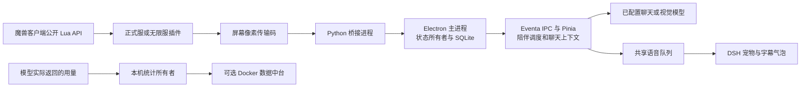

# 魔兽陪伴精灵开发交接

交接日期：2026-11-08。本文面向首次接手项目的开发者及其 AI。文中的相对路径均以产品仓库根目录为起点。

## 1. 先确认目录与交付状态

**唯一开发目录是 `I:\GameTools\wow-airi-companion`。桌面源码在 `airi/`，插件和配套服务在 `WOWAddons/`。** 新电脑可以使用其他盘符，但必须保留这两个目录的相邻关系。

| 位置 | 当前用途 |
| --- | --- |
| 本仓库根目录 | 唯一 Git 仓库、开发规范、产品 README、统一启动入口和本文 |
| `airi/` | 桌面端源码、共享包、依赖声明、桌面构建和打包脚本 |
| `WOWAddons/` | 魔兽插件、像素桥接、数据中台、游戏数据、启动脚本、使用说明 |
| `assets/` | 已有角色素材和参考资源。不能仅凭目录名判断素材可直接导入桌面端 |
| `backups/`、`logs/` | 本机迁移回退资料与验证日志，均不进入 Git |
| 旧 `I:\GameTools\WOWAddons` | 历史副本和兼容启动入口。不要在这里继续修改源码 |
| 旧 `I:\GameTools\airi` | 已迁移，不再作为源码目录。不要重新创建 |

GitHub 仓库：[LoveWood233/wow-airi-companion](https://github.com/LoveWood233/wow-airi-companion)。`airi/` 原有的独立 Git 元数据已经移出工作树，保存在本机 `backups/migration-20261108-001/source-airi.git`。在 `airi/` 中执行 Git，操作的也是产品根仓库。

**本次迁移及兼容功能合并已纳入产品仓库的统一发布提交。** 接手者从远端 `main` 拉取后，运行 `git rev-parse HEAD`，与维护者核对实际提交号。安装包、依赖、个人配置和本机迁移备份不进入 Git，不能把它们当成源码仓库的一部分。

发布分支为 `main`，迁移前的 Git 基线为 `654f6b5e90f1ce093f890372770cb7a7129dd52d`。该旧提交不包含本次迁移。实际交接以包含本文及迁移源码的最新提交 SHA 为准。

当前维护目标为桌面版 **2.27.1**。正式服插件及桥接为 **2.25.0**，无限服插件为 **1.21.0**。桌面 workspace 的 `package.json` 仍有上游内部版本 `0.12.0-beta.5`，它不是产品安装包版本。产品版本定义在 `airi/apps/stage-tamagotchi/scripts/companion-release/files.ts`。

本机恢复资料位于 `backups/migration-20261108-001/`。该目录保留原目标的 `airi/`、`WOWAddons/` 和原上游 Git 元数据。源目录整体迁入了当前 `airi/`。其中 `source-worktree-after-consolidation.patch` 是兼容功能合并后的差异，不能视为合并前原件。逆向重建的恢复资料在 `source-merge-before/`，使用前先读其说明。

> 本文记录迁移后的源码和本机验证结果。最终结果见第 8 节。另一台电脑、真实游戏和完整安装／卸载流程仍需独立验收。

## 2. 开发者和 AI 的入场步骤

1. 打开产品根目录，先读根 `AGENTS.md`、`README.md` 和本文。
2. 修改桌面代码前，读 `airi/AGENTS.md`。根据其 Task Routing 读取对应 skill 和嵌套规范。
3. 运行下面的只读命令，核对 Git 根、分支、提交和未提交文件。
4. 根据任务读取第 5 节对应源码及 ADR，先找已有实现，再决定修改点。
5. 将方案、用户可见行为和验证范围写清楚。影响游戏协议时同时检查 Lua、桥接和桌面消费方。
6. 修改后运行相关测试、对应 workspace 类型检查和 lint。共享导出发生变化时再运行根类型检查。

```powershell
Set-Location I:\GameTools\wow-airi-companion
git rev-parse --show-toplevel
git remote -v
git status --short
git log -5 --oneline
```

已有工作树有其他人的改动时，先识别归属。不要运行 `git reset --hard`、`git clean`，不要覆盖未提交文件，也不要盲目暂存整个仓库。

用户可见名称统一为“魔兽陪伴精灵”。`@proj-airi/*`、Eventa 名称和内部目录仍保留技术标识，不做全文机械替换。共享包还被网页端和移动端使用，不能因桌面改版直接删除通用实现。

本项目已有 12 个语言目录：`en`、`es`、`fr`、`it`、`ja`、`ko`、`pt`、`ru`、`th`、`vi`、`zh-Hans`、`zh-Hant`。用户已经要求主流语言适配，新功能需补齐对应文本。遵循 `airi/packages/i18n/AGENTS.md`，不要把英文占位当成其他语言的翻译。

## 3. 架构与职责



| 层 | 负责什么 | 维护边界 |
| --- | --- | --- |
| 游戏插件 | 读取公开 API、组装角色和物品快照、判断游戏事件、生成装备比较和游戏提醒 | 装备操作在游戏内确认。不要设计桌面按键注入或读取游戏内存 |
| 像素桥接 | 截图、定位传输码、校验分帧和时效、恢复完整状态、提供本机 HTTP 状态 | 不决定装备优劣，不生成陪伴话术 |
| Electron 主进程 | 桥接生命周期、文件访问、安装下载、数据库、持久状态、后台任务、IPC 校验 | 密钥及任意路径操作留在本层。渲染进程不能直接绕过服务操作文件 |
| 渲染进程与共享聊天包 | 设置、记录展示、上下文拼接、陪伴时机、模型调用、统一语音和字幕 | 使用原生快照和插件决策，不再复制一套游戏规则 |
| DSH 显示层 | 透明动画、动作状态、拖动、缩放、字幕展示 | 只处理表现，不拥有角色存档、记忆数据库或第二套音频播放器 |
| 数据中台 | 接收用户开启后的安装登记与用量累计，展示统计 | 独立部署。不接收角色、聊天、截图、模型密钥或服务商名称 |

跨进程通信使用 `@moeru/eventa`，契约集中在桌面 `src/shared/`。外部输入用 Valibot 校验。新增模块先明确唯一状态所有者，避免多个窗口重复运行调度、统计、播放和桥接。

### 3.1 游戏传输与版本

- 正式服插件目录为 `WOWAddons/WoWMapCompanion`，协议标记 `WCP1`，本机桥接默认端口 `18765`。
- 无限服插件目录为 `WOWAddons/WoWForeverCompanion`，协议标记 `WCF1`，默认端口 `18766`。内部枚举 `forever` 是既有契约，不随界面中文改名。
- 当前紧凑传输网格为 64×64。单帧上限 512 字节，其中载荷上限 504 字节。完整快照通过分帧发送。
- 角色快照 v3、登录及脱战小帧 v1、容器流 v2、装备比较体 v2 分别演进。修改一个字段前先查实际编解码和测试，不能只修改文档版本号。
- 桥接暴露 `GET /health`、`GET /api/status` 和 `POST /api/reconnect` 等本机接口。通过 desktop 的 `CompanionBridgeRuntime` 托管，正常用户无需单独启动桥接。
- 区分角色身份、游戏登录会话和桥接连接。桥接重连不能清空本次登录的累计脱战次数，也不能把旧角色分帧接入新角色状态。
- 详细协议见 [传输协议](WOWAddons/WoWCompanion-PROTOCOL.md)。改动必须保留校验、重复帧处理和快照过期行为。

### 3.2 插件优先承担的游戏功能

插件负责装备比较、属性取舍、候选装备以及任务提醒候选。桌面端读取插件结论，展示原因、播报并用于聊天。不要重新引入桌面装备评分器。

换装需要游戏内用户点击确认。此前桌面气泡“好／不用”的第二套换装确认已被精简，不能从迁移备份中恢复。战斗、物品缓存未完成、装备限制和失效候选需要按插件现有状态处理。

背包、银行、专业材料、配方、工具、专业装备和制作成品读取遵循客户端公开能力。银行页面未打开时使用带时间的已知快照，不能把“未读到”显示成“空银行”。分类为制作成品不等于能证实其实际制作来源，无法确认时保留未知标记。

## 4. 已实现的功能及使用边界

| 模块 | 当前行为 |
| --- | --- |
| 角色状态 | 正式服和无限服独立设置，接收角色名称、等级、阵营、种族、地图、坐标、战斗及生死状态 |
| 角色记录 | 按角色保存金币收支、现实时间升级历史、当前装备快照和最近 10 条装备获取记录。离线时间计入升级间隔 |
| 装备提醒 | 插件判断改进和属性取舍，桌面展示或祝贺播报。实际穿戴在游戏内确认 |
| 物品档案 | 背包与银行容器快照进入本机 SQLite，支持专业物品查看及聊天上下文 |
| 聊天称呼 | 默认使用最新登录角色名。明确要求“叫我 X”可保存自定义称呼，并可恢复角色名模式 |
| 语音和字幕 | 使用已配置 TTS，统一播放、音量、静音和取消。播报结束约 3 秒后关闭字幕，未配置语音时使用文字回退 |
| 主动陪伴 | 结构化记忆、关系阶段、相关话题筛选、脱战与时间双重门槛、免打扰和事件记录 |
| 地图互动 | 地图、副本、战场变化可触发逸闻。需要真实地图信息和对应模型可用 |
| 截图聊天 | 独立开关和频率设置，定时看风景。“看看这个／看看我的”等表达可为本次对话附加截图 |
| 桌面形象 | DSH 动画宠物替代桌面 Live2D、VRM、MMD 显示，支持内置宠物、导入、缩放和动作反馈 |
| 插件中心 | CurseForge API 浏览、分类、下载和安装。提供正式服、怀旧服、无限服入口及各版本安装目录设置 |
| 辅助工具 | 游戏启动、使用引导、本地资料查询、专业材料、任务与构筑页面、数据更新、备份、交付及本地升级 |
| 安装和用量统计 | 首次告知后由用户完成开启，可关闭。每 300 秒上报累计用量，未配置服务器时不发送 |

“已有功能”不代表所有游戏版本与服务器已做真实联机验收。无限服 API 兼容性、银行数据、第三方插件下载权限以及视觉模型能力都需要在目标环境检查。

### 4.1 主动闲聊与记忆规则

普通闲聊默认每 5 分钟检查，可设 2–30 分钟。同时要求本次角色登录累计至少 5 次脱战，可设 5–30 次。登录后也先累计，成功互动后重置次数。现实时间持续计时，战斗期间不播报，脱战稳定 10 秒后再判断。

必须同时满足时间间隔、脱战次数、有效角色状态、免打扰和播放就绪条件。没有合适话题时不调用模型。自然闲聊结合相关记忆生成 1–2 句，固定事件通知优先用翻译模板。

明确偏好可以保存并轻提示。不确定推测先询问。普通经历最多 100 条，装备近期记录最多 10 条。收藏和偏好进入可配置长期容量，默认 1000 条，范围 100–100000。容量满时由用户整理或扩容，不自动删除收藏来腾空间。

关系为初识、熟悉、信赖、默契，分数门槛为 0／50／150／300。升级加 10，首次共同到访地图加 5，每日最多加 30。同一事件不重复计分，离线不扣分。记忆可查看、删除，并停止主动提起。

只有相关长期记忆实际被上下文预算截断时，才提示上下文不足，每天最多一次。不要把容量提醒写成付费恐吓或要求用户持续在线。

截图闲聊单独设置，间隔为 1–60 分钟。1–5 分钟控制条为红色，并提示模型额度消耗，其余为绿色。截图会发送到用户配置的视觉模型，功能开关、捕获范围和模型选择需要保留。

### 4.2 语音和 DSH 的关键约束

聊天模型、TTS、听力和视觉是不同服务配置。语音试听有声音，不代表聊天播放队列、主窗口 host 或自动朗读设置正常。

统一语音实现位于 `airi/packages/stage-ui/src/composables/use-desktop-pet-speech.ts`。桌面 `use-dsh-pet-speech.ts` 是薄封装。主窗口拥有实际 speech host，设置页及 workspace 预览不能再注册一个。通知与聊天共用 VoiceStore，保留 turn 身份、取消和旧回复丢弃规则。

DSH 使用 A/B 视频切换及透明 2D Canvas。`dsh-pet-alpha.ts` 处理透明度采样，不能恢复不兼容的旧 WebGL 路径。动画包含休息、交互、思考、说话及情绪反馈。跨屏漫游和抛掷物理尚未接入。

内置资源在 `airi/apps/stage-tamagotchi/src/renderer/public/dsh-pet/builtin/`，保留随附的 MIT LICENSE。运行时不依赖原始 `F:\github_repository\dsh-pet`。第三方宠物通过 `pack.json` 和白名单 WebM 导入，复制到用户目录，使用 `dsh-pet://` 私有协议访问。导入保留路径、符号链接、数量和大小校验，不能直接加载任意本地路径。

### 4.3 插件中心和数据中台

CurseForge API Key 由用户在插件中心设置中配置。申请步骤已写入使用说明。主进程用 Electron safeStorage 保存密钥，渲染进程只接收脱敏结果。安装有单实例锁、目标目录校验、收据和备份。无限服不能直接假设与正式服文件兼容。

数据中台位于 `WOWAddons/WoWCompanionDataHub/`，独立 Python 服务，提供 Docker Compose 和管理网页。无需部署桌面软件或游戏。部署命令和 HTTPS 配置以其 [README](WOWAddons/WoWCompanionDataHub/README.md) 为准。

安装数是随机安装 ID 数量，不是自然人数。Token 只累计模型 SDK 实际返回的字段，缺失保持未知，不按字数估算。当前口径不覆盖 TTS／ASR 费用，也不是账单。累计序列和服务端增量事务防止重试重复计数。每日趋势按服务器 UTC 接收日计算。

默认服务器地址为空。当前未提供已部署域名。管理员密钥只放服务器，不能嵌入客户端。服务器生产环境使用 HTTPS 反向代理，SQLite 命名卷持久化，当前单实例设计不能直接横向扩容。

## 5. 按任务查源码

| 任务 | 首先读取 |
| --- | --- |
| Electron 注册、服务生命周期 | `airi/apps/stage-tamagotchi/src/main/index.ts` |
| 角色状态和桥接所有权 | `airi/apps/stage-tamagotchi/src/main/services/airi/wow-companion.ts` 及同目录 `wow-companion-client.ts`、`wow-companion-runtime.ts` |
| SQLite 物品快照 | `airi/apps/stage-tamagotchi/src/main/services/airi/wow-companion-item-storage.ts`。表为 containers、slots、bridge_cursors |
| 金币、等级、装备、角色档案 | 上述 main services 目录内的 `wow-companion-*` 文件，各自持有对应状态 |
| 记忆与关系持久化 | `airi/apps/stage-tamagotchi/src/main/services/airi/wow-companion-memory.ts` |
| 跨进程契约 | `airi/apps/stage-tamagotchi/src/shared/` 和其中 `eventa/` |
| 主动互动总入口 | `airi/apps/stage-tamagotchi/src/renderer/stores/wow-companion.ts`，配合 `wow-companion-idle.ts`、`wow-companion-chatter-policy.ts`、`wow-chatter-settings.ts` |
| 记忆、称呼与地图 | 同一 stores 目录中的 `wow-companion-memories.ts`、`wow-companion-player-address.ts`、`wow-player-address-settings.ts`、`wow-companion-location-lore.ts` |
| 截图和视觉 | 同一 stores 目录中的 `wow-screen-assist*.ts`、`wow-scenery-controller.ts`，以及主进程 `wow-screen-assist` 服务 |
| 桌面宠物及字幕入口 | `airi/apps/stage-tamagotchi/src/renderer/pages/index.vue`、`components/dsh-pet-stage.vue`、`App.vue` |
| DSH 动画、资源和导入 | renderer 的 `utils/dsh-pet-animation.ts`、`utils/dsh-pet-alpha.ts`，主进程 `dsh-pet.ts`、`dsh-pet-library.ts` |
| 聊天与声音 | `airi/packages/stage-ui/src/stores/chat/`、`stores/voice.ts`、`stores/modules/` 和 `composables/use-desktop-pet-speech.ts` |
| 聊天输入和历史 | `airi/apps/stage-tamagotchi/src/renderer/components/InteractiveArea.vue` |
| 插件下载安装 | 主进程 `wow-addons.ts`、`wow-addons-catalog.ts`、`wow-addons-install.ts`、`wow-addons-settings.ts` |
| 统计链路 | `airi/packages/core-agent/` → `airi/packages/stage-ui/src/libs/model-usage.ts` → renderer `App.vue` → 主进程 `wow-statistics-service.ts` |
| 传输码与客户端读取 | `WOWAddons/WoWMapCompanion/`、`WOWAddons/WoWForeverCompanion/`、`WOWAddons/WoWCompanionBridge/` |
| 启动、安装包与升级清单 | 根 `Start-WoWCompanion.cmd`、`WOWAddons/Start-WoWCompanion.ps1`、desktop `electron-builder.config.ts`、`scripts/companion-release/` |
| 静态地图与门户数据库 | `WOWAddons/data/retail-portals/`，其中 README 说明来源与生成方式 |

不要根据表中简写新建同名服务。使用 `rg --files` 找到实际文件，检查同目录测试、类型和消费者。主进程相关文件名可使用 `rg --files airi/apps/stage-tamagotchi/src/main/services/airi` 查询。

## 6. 开发环境、启动与新电脑准备

### 6.1 环境版本

`airi/.tool-versions` 声明 Node.js **26.7.0**、pnpm **11.24.0** 和 dotnet **10**。本产品主要开发链路使用 Node 和 pnpm。Python 源码桥接需要 Windows Python 3.10+，数据中台按其 README 使用 Python 3.13+。安装包内桥接自带 Python。

新电脑先获得包含本次迁移的提交，再从 `airi/` 安装依赖。不要复制本机 `node_modules`、绝对 Junction 或生成的 `.bin` 包装器。

```powershell
Set-Location <项目根目录>\airi
node --version
pnpm --version
$env:SKIP_INSTALL_SIMPLE_GIT_HOOKS = '1'
pnpm install --frozen-lockfile
Remove-Item Env:\SKIP_INSTALL_SIMPLE_GIT_HOOKS
pnpm -F @proj-airi/i18n build
pnpm run dev:tamagotchi
```

完整新电脑安装尚未验收。安装会下载依赖并运行 postinstall，需准备网络和平台构建前提。遇到失败保存首个错误，先核对版本，不要立即重写 lockfile。

首次安装暂时跳过 Git hooks 安装。上面的 `SKIP_INSTALL_SIMPLE_GIT_HOOKS=1` 是当前 simple-git-hooks 支持的安装开关，其他 postinstall 构建照常执行。安装结束后移除该变量。

原因是原 `airi/package.json` 的 postinstall 仍调用 simple-git-hooks，其默认安装路径会在 `airi/.git/hooks` 创建目录。原钩子命令 `pnpm nano-staged` 也假定 Git 根就是 pnpm 根。合并仓库后需要单独配置产品根级 hooks，命令从产品根明确调用 `pnpm --dir airi exec nano-staged`。维护者修复安装路径并验证前，不启用原钩子，也不要用 `SKIP_SIMPLE_GIT_HOOKS` 跳过提交检查代替修复。钩子尚未配置时，提交前手动执行第 8 节的相关检查。

本机迁移后曾显示 node_modules 与 stage-ui 安装元数据不一致警告。维护者临时通过下面的环境变量继续运行已迁移依赖，避免无关自动重链：

```powershell
$env:pnpm_config_verify_deps_before_run = 'warn'
```

这不是新电脑必须采用的配置。迁移已通过 82 个 workspace 的 `pnpm install --lockfile-only --ignore-scripts --offline --frozen-lockfile`，退出 0。锁文件与声明兼容，不能把缓存元数据差异直接认定为锁文件损坏。

### 6.2 普通启动与配置目录

用户双击产品根目录的 `Start-WoWCompanion.cmd`。入口调用仓库内脚本，选择可用的产品程序。新电脑仅 clone 源码时没有已构建 EXE，需要先构建或使用发布安装包。

固定用户目录默认为 `%USERPROFILE%\.airi-wow-companion`。可通过 `APP_USER_DATA_PATH` 或启动脚本 `-UserDataPath` 指定。不要把开发 profile 与测试 profile 混用，否则会误判模型配置、角色记录或统计身份丢失。

应用从系统托盘正常退出后再迁移个人配置。故障排查可以使用独立临时 profile，不能清空用户原始目录来验证。启动脚本参数及日志路径以 `WOWAddons/Start-WoWCompanion.ps1` 为准。

## 7. 构建与安装包

### 7.1 先构建桌面应用

以下命令在 `airi/` 运行。本机迁移环境保留第 6 节的临时环境变量。

```powershell
pnpm -F @proj-airi/i18n build
pnpm -F @proj-airi/stage-tamagotchi typecheck
pnpm -F @proj-airi/stage-tamagotchi build
```

### 7.2 首次准备安装包内 Python

**Git 不包含 `resources/wow-companion-python/`。** 新电脑打包前需要运行准备脚本，否则不能交付自带桥接的安装包。

```powershell
# 当前目录为 airi/
powershell.exe -NoProfile -ExecutionPolicy Bypass -File apps/stage-tamagotchi/scripts/companion-release/prepare-python.ps1
```

脚本下载官方 CPython 3.14.10 Windows x64 嵌入包并验证固定 SHA256。输出到 `apps/stage-tamagotchi/resources/wow-companion-python/`，保留许可证和 `runtime-source.json`。重复运行会校验已有资源，不覆盖未知版本。该解释器隔离运行，不依赖 pip、Pillow 或目标电脑上的 Python。

已打包程序若发现内置运行时损坏，会报前置检查错误，不静默改用系统 Python。详情见 [嵌入 Python ADR](airi/docs/ai/adr/wow-companion-embedded-python.md)。

### 7.3 Windows x64 打包

下面在 `airi/apps/stage-tamagotchi/` 运行，先确认 `files.ts` 中产品版本与输出目录一致。

```powershell
$env:CSC_IDENTITY_AUTO_DISCOVERY = 'false'
pnpm exec electron-builder --config electron-builder.config.ts --dir --win --x64 --publish never --config.extraMetadata.version=2.27.1 --config.directories.output=dist-portable-2.27.1
pnpm exec electron-builder --config electron-builder.config.ts --win nsis --x64 --prepackaged .\dist-portable-2.27.1\win-unpacked --publish never --config.extraMetadata.version=2.27.1 --config.directories.output=dist-setup-2.27.1
```

首次打包需要下载对应 Electron 和打包工具。本机已有 `WOWAddons/.cache/electron-sdk-43.4.1` 时，第一条命令可附加 `--config.electronDist=<项目根目录>\WOWAddons\.cache\electron-sdk-43.4.1`。这个缓存不会随 Git 提供。

`electron-builder.config.ts` 会从同级产品目录中的 `WOWAddons/` 收集插件、桥接白名单、指南和数据。版本与哈希清单由 `scripts/companion-release/files.ts` 生成。不要手工修改打包输出中的源码来代替重新构建。

预期安装包名为 `WoWCompanion-2.27.1-windows-x64-setup.exe`。当前安装包未配置代码签名证书。发布前用临时 profile 检查版本、主窗口、设置、DSH、桥接退出和内置 Python，再检查安装／卸载及用户数据保留。

`WOWAddons/build-delivery.py` 是历史 2.20 增量源码包脚本，含固定旧基线。仓库层级已经改变，不能把它当成当前完整源码交接入口。维护该脚本前先重新设计 Git 路径、版本和收集范围。

## 8. 测试命令与本次验收状态

测试按改动范围选择。下列命令是入口，不代表本次全部执行。真实客户端、屏幕缩放和操作系统音频仍需要独立验收。

```powershell
# 当前目录为 airi/
pnpm -F @proj-airi/stage-ui typecheck
pnpm -F @proj-airi/stage-pages typecheck
pnpm -F @proj-airi/stage-tamagotchi typecheck
pnpm exec vitest run --config apps/stage-tamagotchi/vitest.config.ts --project node dsh-pet-library.test.ts dsh-pet-animation.test.ts
pnpm exec vitest run --config apps/stage-tamagotchi/vitest.config.ts --project browser dsh-pet-stage.browser.test.ts dsh-pet-settings.browser.test.ts dsh-pet-alpha.browser.test.ts use-dsh-pet-speech.browser.test.ts app.browser.test.ts local-routes.browser.test.ts
pnpm lint
# 修改共享导出时还要运行
pnpm typecheck
```

浏览器测试必须指定桌面 Vitest 配置。默认根 Vitest 命令不包含这些 browser projects。缺少 Playwright 浏览器时按对应安装错误准备浏览器，不能用模拟 Vue／Pinia 来掩盖真实组件问题。

```powershell
# 当前目录为产品根
powershell.exe -NoProfile -ExecutionPolicy Bypass -File WOWAddons/tests/test-launcher.ps1
python -m unittest discover -s WOWAddons/WoWCompanionBridge -p 'test_*.py'

# 插件测试运行实际 Lua 5.1，先在对应插件目录安装测试依赖
Set-Location WOWAddons/WoWMapCompanion
python -m pip install --target tests/.deps lupa
python -m unittest discover -s tests -v
# 无限服：在 WOWAddons/WoWForeverCompanion 中执行同样的两条命令

# 数据中台：在 WOWAddons/WoWCompanionDataHub 中运行
python -m unittest discover -s tests -v
```

| 本次迁移检查 | 截至本文编写时的结果 |
| --- | --- |
| 物理迁移与依赖路径 | 已完成迁移、10,146 个依赖 Junction 重定位及约 800 个生成包装器／元数据路径修复。独立解析审计通过 |
| 锁文件与依赖声明 | 82 workspace 离线 frozen lockfile-only 检查退出 0。完整新电脑安装未验收 |
| 兼容功能合并 | 自定义称呼与通知历史保留逻辑已合入。相关 Node 93 项、定向 browser 32 项通过，后者另有 113 项因名称筛选跳过。称呼设置 12 语言补齐 |
| 桌宠回归、启动及发行脚本 | 6 个 browser 文件共 41 项通过。启动脚本 14 项、发行清单 6 项通过 |
| 发布前桥接回归 | Python 桥接 test_*.py 全量 317 项通过，启动脚本 14 项再次通过。日志位于本机 logs/github-publish-20261108/ |
| 2.27.1 桌面构建与打包 | i18n、桌面完整构建及共享 stage-ui／stage-pages 类型检查通过。第 7 节的 Windows x64 发行目录与 NSIS 安装包已生成。builder 的 extraMetadata.version 统一使用 companionReleaseVersion，主程序版本为 2.27.1 |
| 2.27.1 EXE 启动 | 打包 EXE 使用隔离 profile 启动成功，透明动画、右键睡觉／唤醒和设置预览通过，页面脚本错误 0。测试关闭游戏连接，未使用个人配置或调用模型服务 |
| 发行资源完整性 | 338 个清单文件及 87 项配套资源的大小和 SHA-256 通过。114 段 WebM 与源码一致，MIT 许可证存在，未发现被禁止的私有配置路径 |
| 内置桥接运行时 | 包内 Python 3.14.10 可执行，使用该运行时执行包内 server.py --help 退出 0。未进行真实截图和游戏连接验收 |
| NSIS 安装包 | WOWAddons/WoWCompanion-2.27.1-windows-x64-setup.exe 已生成，681,476,830 字节。SHA-256 为 a9a0e7073f3a4ae0e03dd9a2082b972099bdd87eee8a0ccf0fb0dbed879659af，旁有 .sha256 文件。内嵌 339 个文件完整性检查通过，未签名。未实际安装／卸载 |
| 全仓类型检查 | 本次 pnpm typecheck 在独立场景包 scenarios-stage-tamagotchi-browser 缺少 vue-tsc 时退出 127，不能记为通过。历史 core-agent Responses SDK 类型问题需另行复核，本次全仓命令未完成该包检查 |
| lint | 最终 pnpm lint 退出 0，0 错误、669 条已有警告 |
| Docker／新电脑／真实游戏 | 本次未完成这些环境的整体验收 |

迁移本机日志位于忽略的 `logs/migration-20261108/`。交接时在 PR 或发布记录补入实际命令、退出码、日志摘要和未通过原因。不要用历史版本的测试数量替代当前源码验证，也不要修改 tsconfig 隐藏既有错误。

## 9. 数据、密钥与备份

| 数据 | 位置及处理方式 |
| --- | --- |
| 用户配置总目录 | `%USERPROFILE%\.airi-wow-companion`，含 Local Storage、IndexedDB 和 JSON。整体视为个人数据 |
| 服务商及模型密钥 | 配置存储内可能含明文或系统加密值。不可打印到日志、截图、文档和 Git |
| 游戏设置 | `wow-companion-v1.json`、`wow-companion-forever-v1.json` 等用户配置文件 |
| 结构化记忆 | `wow-companion-memory-v1.json`，主进程按人物、游戏、账号及 GUID 绑定 |
| 背包／银行 | `wow-companion-items.sqlite` 及可能存在的 `-wal`、`-shm`。使用应用逻辑备份或 SQLite backup API |
| CurseForge Key | `wow-addons-v1.json` 内的系统加密配置，不直接交给渲染进程。跨电脑或 Windows 账号复制密文后可能无法解密，应在新电脑重新填写 |
| DSH 导入 | 用户目录内的 `dsh-pet-packs/` 和选择设置，不能当公共默认素材提交 |
| 安装统计身份 | 独立随机安装 ID 和 secret，普通配置备份不复制该身份，避免两台电脑共用安装标识 |
| 桥接校准 | `bridge-config*.json*` 等本机文件，忽略并保留，不能写成通用游戏窗口参数 |
| 中台服务 | `.env`、`secrets/admin-key.txt`、SQLite、卷和备份均保持私有 |

SQLite 正在写入时不能只复制主库文件。执行恢复前停止写入，避免把旧主库与新 WAL 混用。客户端备份由 `wow-backup-*` 服务负责，中台在线备份参考其 README。

应用导出的 `.wowbackup.json` 是白名单逻辑备份，按用户选择保存受支持设置、游戏历史和聊天。它不是完整 profile 克隆，不包含服务商及 API Key、任意 IndexedDB 数据、DSH 导入包和安装统计身份。恢复这些备份后，新电脑仍需配置模型服务和安装路径，单独导入自定义宠物。

导出会移除已识别的结构化凭据字段，但不会清洗用户写下的全部自由文本。角色、记忆、聊天和随聊天导出的图片仍可能包含个人信息。备份文件继续私密保管，不能当作可公开提交的脱敏样本。具体边界见 `airi/apps/stage-tamagotchi/src/shared/wow-backup.ts` 和 `airi/apps/stage-tamagotchi/src/main/services/airi/wow-backup-repository.ts`。

`.gitignore` 已排除依赖、构建输出、安装包、备份、日志、缓存、嵌入 Python 和本机配置。提交前仍需检查 `git diff --cached`，必要时用 `git check-ignore -v <文件>`。不要把用户许可的“私人配置迁移包”当成公开开发交接包。

## 10. 多人协作与合并约定

1. 双方先拉取共同发布分支，核对准确 SHA。远端未同步的工作树不能当成共同开发基线。
2. 每人从共同基线创建自己的分支，例如 `username/feat/short-name`。较大并行任务使用独立 worktree。
3. 同一项任务先约定所有者和修改文件。协议、主进程所有者与共享语音 host 不交给两人同时大改。
4. 更新前先 `git fetch origin` 和检查差异。工作树干净后按仓库规则 rebase，不覆盖别人的未提交内容。
5. 按文件选择暂存，采用 Conventional Commits，例如 `feat(companion): add memory topic filter`。
6. 代码、对应文档和测试放在同一 PR。AGENTS 等 agent 配置单独提交，但可放在相关 PR。
7. PR 写清用户行为变化、状态所有者、协议／数据迁移、实际验证和已知限制。准备 PR 前读取本地 create-pr skill。
8. 合并后按最终提交重新检查关键 UI／交互。完成产品根 CI 迁移后，再确认 CI 测试的是当前 HEAD。

当前旧工作流位于 `airi/.github/workflows/`，产品根尚无 `.github/workflows/`。GitHub 不会自动执行嵌套目录中的这些工作流，不能据此声称产品仓库已有自动 CI。迁移工作流时需要逐项调整工作目录、缓存、路径过滤、产物路径和权限，先验证不含发布或凭据风险的检查任务。完成前由开发者运行本地检查并在 PR 中记录结果。

不要在迁移备份里继续开发。不要恢复备份中的嵌套 `.git`。不要将本机依赖 Junction、绝对盘符、用户 profile、安装包或 API Key 提交。

新库选择遵循 `airi/AGENTS.md`，先检索已有能力，再与用户确认依赖选择。TypeScript 不使用 `any`，跨进程统一 Eventa，输入统一 Valibot。测试只在数据库、网络、时钟和文件系统等外部边界做替身，不用大范围 mock 代替组件集成验证。

## 11. 后续工作与已知限制

- 接手时记录包含迁移结果的准确 SHA，不能以迁移前基线代替。后续并行任务从共同基线创建各自分支。
- 在干净的新电脑执行依赖安装、Python 准备、构建和安装包验收，记录下载及系统前提。
- 单独处理全仓类型检查的既有缺失工具和 Responses SDK 类型问题，不在业务 PR 中静默改类型配置。
- 将需要的 CI 工作流迁移到产品根 `.github/workflows/`，适配 `airi/` 工作目录和产品插件路径，并确认实际在当前提交运行。
- 如需发布签名，另行准备证书和发布流程。当前本机包不能被描述为已签名发行版。
- 真实游戏测试需覆盖角色切换、插件重载、银行未打开、背包大量变化、窗口缩放、桥接重连和战斗限制。
- 统计服务器尚未部署。部署后才能配置公共 HTTPS 地址，验证首次告知、关闭、离线重试和去重。
- DSH 未接入跨屏漫游与抛掷物理。不要将原 dsh-pet 项目的能力全部列成已移植能力。
- 旧 HTML、嵌套 README 和 snapshot-manifest 中保留历史说明。本次根 README、本文及实际源码优先，冲突处随对应改动修订。
- 查询《魔兽世界：无限》配方、物品、任务、副本、天赋或拍卖行价格时，优先使用 wuxianwow MCP。注明“无限图鉴 wuxianwow.com”并附链接，不能以其他版本数据冒充。

## 12. 推荐阅读顺序与 AI 任务模板

第一轮阅读根 `AGENTS.md` → 本文 → 根 `README.md` → `airi/AGENTS.md` → 对应源码与测试。以下 ADR 解释需要保留的决策：

- [桌面与插件职责](airi/docs/ai/adr/wow-companion-responsibilities.md)
- [装备决策权](airi/docs/ai/adr/wow-equipment-authority.md) 与 [游戏提醒决策权](airi/docs/ai/adr/wow-game-reminder-authority.md)
- [背包银行持久化](airi/docs/ai/adr/wow-item-storage.md) 与 [角色档案](airi/docs/ai/adr/wow-companion-character-archive.md)
- [主动互动](airi/docs/ai/adr/wow-companion-proactive-speech.md)、[节奏](airi/docs/ai/adr/wow-companion-rhythm.md) 与 [用户称呼](airi/docs/ai/adr/wow-companion-player-address.md)
- [截图辅助](airi/docs/ai/adr/wow-screen-assist.md)、[固定用户目录](airi/docs/ai/adr/wow-companion-stable-profile.md) 与 [备份](airi/docs/ai/adr/wow-companion-backup.md)
- [CurseForge 插件中心](airi/docs/ai/adr/wow-addons-curseforge.md) 与 [安装统计](airi/docs/ai/adr/wow-installation-statistics.md)
- [用户说明 HTML](WOWAddons/wow-companion-implementation.html) 与 [插件桥接说明](WOWAddons/WoWCompanionBridge/README.md)

给另一位开发者的 AI 可以使用下面这段指令。将根路径、基线和任务替换成真实值：

```text
项目：魔兽陪伴精灵。
根目录：<本机产品仓库路径>。
桌面源码 airi/，游戏插件和配套服务 WOWAddons/。
本任务基线：<双方确认的分支和提交 SHA>。
先读根 AGENTS.md、HANDOVER.md 和 README.md，再读 airi/AGENTS.md 及任务对应规范。
先核对 Git 根和未提交文件，保留他人改动。
所有修改都在产品仓库内，不恢复旧 I:\GameTools\airi 或外部 WOWAddons 开发副本。
任务：<具体用户行为与验收条件>。
先报告现有入口、唯一状态所有者和计划修改文件，再实施。
保留插件游戏规则、原生数据所有者、统一语音 host 和安全 IPC 边界。
新文本适配现有 12 语言。
完成后列出实际修改、测试命令、结果和未通过原因，不宣称未验证的新电脑或真实游戏结果。
不要提交密钥、个人配置、依赖、备份、日志和构建产物。
```
