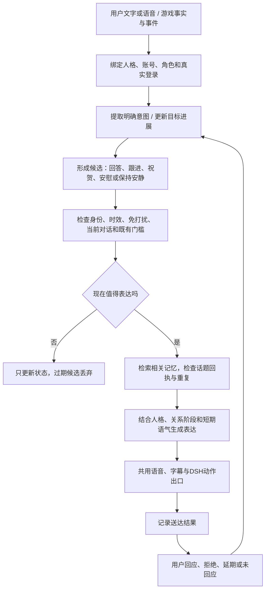

# 陪伴精灵人性化交互设计方案

- 状态：**提案，供用户评审，尚未开发**。
- 日期：2026-11-08。
- 项目：魔兽陪伴精灵。
- 唯一开发目录：`I:\GameTools\wow-airi-companion`。
- 设计依据：当前工作树，包含本机2.28.0武器熟练度增量。不能仅以远端旧提交判断现有能力。
- 阅读顺序：先看第2、3、13、15节。开发者再看数据、接入点和验收部分。

## 1. 目标与范围

让用户感受到：精灵听懂了刚才的话，记得自己在意的事，会在合适的时候接着聊。

第一版围绕五种体验开发：

1. 对话能承接。上一句话里的问题、计划和情绪，不会在下一次回应中丢失。
2. 目标有后续。用户说过要做的事，可以记录进展、识别完成，并在适当时机回访。
3. 关心有依据。只引用真实收到的游戏事实、用户原话和可用记忆。
4. 开口有分寸。根据回应、拒绝和当前活动调整节奏。
5. 性格有连续性。关系加深后表达更熟悉，仍保留用户选择的人格。

本方案沿用现有模型服务、记忆存储、语音队列、字幕和DSH动画。
插件继续负责游戏事实与规则判断，桌面负责对话和表达。

## 2. 现有基础与本次增量

以下“已有”均指源码能力。客户端、模型服务和语音效果仍受实际环境影响。

| 领域 | 已有能力 | 本方案增加什么 |
| --- | --- | --- |
| 游戏观察 | 角色、地图、装备、金币、等级、任务、战斗与武器熟练度等可用观察 | 将相关观察与用户明确目标关联，形成进展证据 |
| 记忆 | 偏好、经历、当次登录目标、收藏装备，支持查看、删除和停止主动提起 | 目标的结构化条件、进展和结果；话题回访回执 |
| 目标保存 | `session-goal`与聊天记忆工具已经存在 | 扩展目标的跟进能力，复用现有保存入口 |
| 话题筛选 | 已有角色隔离、相关性、过期过滤和已提及过滤 | 在原筛选后增加语义话题去重、回应与延期判断 |
| 关系 | 初识、熟悉、信赖、默契四阶段，已有成长和奖励去重 | 明确每个阶段如何改变措辞、询问方式和回访尺度 |
| 地图互动 | 已有稳定观察、全局冷却、目的地去重和过期待办清理 | 与当前目标、正在进行的对话协调，减少接连说多段话 |
| 固定通知 | 已有一个待播槽和一个活动通知，按优先级替换 | 对允许合并的普通事件生成一次完整表达 |
| 语音与表现 | 共用语音出口，已有字幕和DSH动作联动 | 根据表达意图选择可用动作，保持语音、字幕与动作一致 |

### 2.1 当前规则必须保留的含义

- 普通闲聊默认5分钟，可设2–30分钟。
- 普通闲聊同时要求本次真实游戏登录累计N次脱战。N默认5，可设5–30。
- 登录后也先累计N次，脱战稳定10秒后才判断。
- 只有实际送达的互动才消耗资格。失败或没有话题不消耗。
- 现有当次目标绑定真实游戏登录。新登录使旧目标过期，桥接重连不等于新登录。
- 同一角色、同次登录的新目标会替换原目标。本期先保留这一数量限制。
- 关系分数按精灵人格保存，角色事实按游戏、账号和角色保存。
- 离线不扣关系分。模型不能直接修改关系分数。
- 装备穿戴仍由用户在游戏内确认。
- 记忆容量、收藏、删除、停止主动提起和上下文截断提示继续遵循现有规则。

普通闲聊门槛的可选调整见第15节。本文不代表用户已经同意修改这些规则。

## 3. 用户实际会体验到什么

以下台词均为原创示例，不是希尔瓦娜斯的官方台词。

### 3.1 练习武器：从记住一句话到见证进展

| 时机 | 系统处理 | 精灵表现 |
| --- | --- | --- |
| 用户说“今晚把剑练到150” | 保存当前角色、当次登录的目标；有歧义时确认具体武器技能 | “150。记下了，看看你今晚的耐心。” |
| 收到剑熟练度125 | 保存可信基线，不立即制造一次闲聊 | 继续当前对话或安静陪伴 |
| 收到熟练度140 | 更新进展；只有话题有新意且主动门槛满足时才可提起 | “还差10点。这把剑，你倒是很有耐心。” |
| 收到熟练度150 | 将目标标记为完成，记录一次完成证据 | 合适时说：“150了。说到做到——这点，我喜欢。” |
| 数值不可读或数据过期 | 保持未知，不计算进展，不宣布完成 | 用户询问时说明“现在读不到，等数据恢复再看。” |

目标状态可以立即更新，主动讲话仍受调度规则限制。
未能及时送达的祝贺不积压成过期播报。下次用户主动聊天时，可以自然承接当前事实。

### 3.2 连续失败：回应方式随上下文变化

第一次失败可以保留用户喜欢的干冷幽默。
短时间连续失败时，降低调侃程度，改为简短提醒或陪伴。

例如：“先停一下。换条路，或者休整再来，我都在。”

连续死亡只能说明游戏事件频繁，不能证明用户沮丧。
用户明确说“烦死了”或“不想被吐槽”时，才把这次表达作为回应依据。
明确要求停止某类调侃时，沿用偏好保存机制。

### 3.3 用户不回应：自然收声

精灵问过一次“这件事还继续吗”，用户没有回答：

1. 标记这次问题尚未回应。
2. 延长同话题的主动冷却。
3. 继续接受游戏事实，但不追问“怎么不理我”。
4. 用户后来主动提到这件事，再接上话题。

沉默不直接变成长期偏好，也不降低关系分。

### 3.4 共同经历：关系体现在说话方式里

用户重新到访曾一起经历过的地图时，复用已有相关记忆筛选。
有亲历证据时，可以说：“上次我们到这里，你还在纠结那把武器。现在倒是像样多了。”

只有离线后补读到的记录时，改为说明“记录里看到”。
不能将补读数据写成精灵亲眼见证的共同经历。

## 4. 统一交互逻辑链



关键分工：

- 插件、桥接提供事实，不生成陪伴话术。
- 主进程拥有需要持久保存的目标扩展和回执。
- 主显示窗口拥有短期对话状态、表达仲裁和语音生命周期。
- 模型生成话术或提出受校验的记忆操作，不决定是否越过免打扰和游戏操作边界。
- 普通聊天、自动闲聊和设置窗口不能各自运行一套主动调度。

## 5. 对话衔接与回应回执

### 5.1 短期对话状态

在现有主显示窗口所有者中增加短期状态，不增加第二份聊天记录。

```ts
interface ConversationThread {
  topicKey: string
  intent: 'answer' | 'follow-up' | 'comfort' | 'celebrate' | 'casual'
  pendingQuestion: string | null
  relatedMemoryIds: string[]
  lastUserMessageId: string
  lastInteractionAt: number
}
```

这段状态用于回答“现在正在聊什么”“还有哪个问题没答完”。
模型输入仍使用原聊天历史，本结构只保存少量索引和意图。

状态按人格、聊天会话和当前角色绑定。
切换角色、切换人格、清除聊天或关闭所有者时清除。
跨重启的事实由现有记忆恢复，不恢复一个已经失效的待回答问题。

### 5.2 话题回执

保留现有 `entry.id + updatedAt` 去重。
新增语义话题标识，避免不同记忆条目反复制造同一问题。

优先使用可确定的标识：目标ID、地图ID、物品实例、事件批次和问题意图。
第一版不引入向量数据库，也不额外调用模型判断两句话是否相似。

建议回执字段：

```ts
interface TopicReceipt {
  topicKey: string
  sourceRevision: string
  state: 'delivered' | 'answered' | 'declined' | 'snoozed' | 'unanswered'
  deliveredAt: number | null
  answeredAt: number | null
  nextEligibleAt: number | null
  unansweredCount: number
}
```

回执还必须包含人格和角色作用域。这里省略这些重复字段。

| 用户行为 | 回执变化 | 后续行为 |
| --- | --- | --- |
| 回答了问题 | `answered` | 正常承接；只有新进展才重新形成同话题候选 |
| “别再问这个” | `declined`，并沿用停止主动提起机制 | 保留已知事实，停止主动回访 |
| “一会儿再说” | `snoozed` | 暂停本话题；不擅自创建系统提醒或定时自动任务 |
| 一次未回应 | `unanswered` | 本次登录内延长该话题冷却 |
| 主动重新提起 | 更新当前线程 | 恢复讨论；不将用户过去的沉默解释为拒绝 |

“刚才说的不用了”存在多个可能对象时，只问一句确认。
不能将一个模糊的“不用”同时取消多个目标。

### 5.3 送达与播放的区别

现有闲聊在字幕展示、写入聊天后登记已提及，再尝试TTS。
新回执沿用这个送达定义，避免语音失败后无限重试同一句。

- 模型生成失败且文字未展示：不标记送达，不消耗闲聊资格。
- 字幕已展示但TTS失败：标记已送达，保留文字，不再次追问。
- 用户插话中断语音：停止剩余播放，记录中断，优先处理用户消息。
- 回应归属不清楚时，不让模型强行判断用户回应了哪一次问题。

## 6. 扩展现有目标，形成可验证的进展

### 6.1 第一版支持的目标

| 目标类型 | 可自动核对的证据 | 限制 |
| --- | --- | --- |
| 达到某等级 | 当前角色有效等级观察 | 不将现实时间推算成升级进度 |
| 某武器熟练度达到指定值 | 有效 `weaponSkills` 中的技能ID和rank | 正式服不支持；未知值不当成0 |
| 到达指定地图 | 当前有效地图ID | 到达地图不等于完成地图任务或副本 |
| 自由描述目标 | 用户主动报告结果 | 没有可验证证据时，不自动宣布完成 |

“刷到某件装备”“完成某个副本”等目标可先作为自由描述保存。
后续只有接入明确、可靠的完成证据，才启用自动判断。

### 6.2 数据结构建议

在现有 `session-goal` 条目下增加结构化目标元数据，复用其ID和身份字段。

```ts
type GoalTarget
  = | { kind: 'level', target: number }
    | { kind: 'weapon-skill', skillLineID: number, target: number }
    | { kind: 'visit-map', mapID: number }
    | { kind: 'free-text' }

interface GoalProgress {
  target: GoalTarget
  outcome: 'tracking' | 'achieved' | 'cancelled'
  lastVerifiedValue: number | null
  lastVerifiedAt: number | null
  lastEvidenceId: string | null
  achievedAt: number | null
}
```

上例是设计草图。正式实现需增加Valibot校验、字段上限和证据约束。
目标的登录有效期继续由现有 `gameSessionId`、`expiresAt`、`expired` 管理。
`outcome`描述目标结果，不替代现有生命周期字段。

### 6.3 保存、更新与完成

1. 从当前用户原话识别明确目标，沿用现有聊天工具的原话证据绑定。
2. 目标有歧义时询问，不用职业、武器外观或旧角色记录猜测。
3. 保存目标时绑定当前角色和真实登录。
4. 收到可信观察后更新最近进展，不为每一点熟练度新建一条长期记忆。
5. 达标时幂等地标记完成，最多形成一次完成候选。
6. 用户明确放弃时标记取消。新目标仍按现有规则替换旧目标。
7. 用户删除或停止主动提起时，同时清理相关待办和回访回执。

API缺失、记录过期、角色切换或桥接错误时，暂停自动核对。
原目标可以保留为未知进展，不能继续用旧值计算剩余量。

### 6.4 跨登录边界

第一版保留“当次登录目标”的现有语义。
桥接重连、UI重载沿用真实登录身份；新游戏登录使旧目标过期。

用户说“明天继续”时，第一版可以在当前对话中回应，但不能承诺已经建立跨日回访。
跨登录目标列为后续可选能力，启用前需要明确容量、有效期和取消方式。

完成后的经历可按现有普通经历规则保存一条摘要，用于以后回忆。
补读或离线期间发生的结果，不升级为精灵亲历，也不额外获得共同经历分数。

## 7. 稳定人格、关系阶段和短期语气

三种状态分开处理：

| 状态 | 变化速度 | 来源 | 保存方式 |
| --- | --- | --- | --- |
| 人格 | 稳定 | 用户选择的人格卡、明确偏好 | 沿用现有配置 |
| 关系阶段 | 长期 | 现有升级、首次共同到访地图和奖励规则 | 沿用现有主进程关系记录 |
| 短期语气 | 分钟级 | 最近游戏事件、用户明确表达、当前对话 | 运行时状态，逐渐恢复平静 |

第一版短期语气只设四类：平静、欣喜、关切、轻松调侃。
它们是表达策略，不是对用户心理状态的诊断。

建议规则：

- 目标完成或明显的新进展：允许短暂欣喜。
- 短时间多次失败：提高关切候选的权重，不认定用户难过。
- 用户明确表达疲惫或不想被调侃：采用更克制的回应。
- 用户主动玩梗且没有拒绝同类表达：允许轻松调侃。
- 没有新证据时，语气逐渐回到平静。

语气不由模型每句话随机决定，也不另建一套需要喂养的心情数值。

### 7.1 希尔瓦娜斯人格的具体表现

| 关系阶段 | 表达侧重 | 原创示例 |
| --- | --- | --- |
| 初识 | 简短、尊重选择，不假设熟悉 | “150是你的目标。需要我留意进度，就说一声。” |
| 熟悉 | 记得用户的做事习惯，少量干冷幽默 | “又选了最费耐心的路。倒也像你。” |
| 信赖 | 可以回指共同经历，关心更具体 | “上次你也在这里卡了很久。这回先换个办法。” |
| 默契 | 减少套话，用简短回应表达理解 | “懂了。你专心练，我留意进度。” |

这些示例只在事实支持时使用。
关系阶段改变措辞，不自动开启更亲昵的称呼、提高讲话频率或扩大记忆收集范围。
称呼继续采用当前角色名或用户已经明确保存的自定义称呼。

## 8. 说话时机与用户反馈

### 8.1 第一版保持现行门槛

候选筛选顺序如下：

1. 当前身份和数据有效。
2. 满足相应功能的开关、免打扰与场景规则。
3. 用户没有在说话，前台聊天或更高优先级表达没有占用出口。
4. 普通主动跟进同时满足时间间隔、N次脱战和稳定10秒。
5. 有新进展或明确可回访的问题。
6. 原话题去重和新语义回执都允许本次表达。
7. 模型预算和播放条件允许。

满足时间条件只产生检查机会，不制造必须说话的任务。
角色离线、休眠或失去有效数据后，不累积待补播的闲聊。

### 8.2 反馈调整只影响当前互动

建议初版参数，均待评审：

| 情况 | 建议处理 |
| --- | --- |
| 一次主动问题未获回应 | 同话题至少等待两个基础闲聊间隔，不低于10分钟 |
| 连续两次同话题未回应 | 本次游戏登录不再主动追问该话题 |
| 用户主动重新提起 | 解除当前话题的临时收声状态 |
| 用户明确要求少说一点 | 通过现有偏好机制保存，并给一次轻提示 |
| 用户要求先安静 | 立即停止当前后台表达，沿用免打扰控制 |

未回应窗口不包含战斗、连接中断、语音仍播放和用户未看到字幕的时间。
第一版可以保守处理：无法确认是否看见，就只延长冷却，不计作第二次未回应。

只要用户主动开始聊天，直接回答其请求，不要求先满足主动闲聊门槛。

## 9. 事件合并与表达仲裁

现有语音出口已经统一，新增的是“提交表达之前”的短暂仲裁。
不要增加第二个播放器或后台语音所有者。

### 9.1 优先级与可合并边界

| 类别 | 处理方式 |
| --- | --- |
| 用户正在进行的聊天、已有装备确认提示 | 沿用现有优先级与取消机制，不等待合并窗 |
| 死亡、复活等有生命周期的事件 | 保留原事件资格和时效，不被旧祝贺覆盖 |
| 普通升级祝贺、允许合并的目标进展 | 最多等待2秒合并相关候选，优先表达一件最重要的事 |
| 地图逸闻、普通闲聊、截图闲聊 | 等待前台空闲，保留各自门槛；过期后丢弃 |

表中是接入原则，不要求改写现有所有优先级数字。
实现前需列出现有优先级表，验证新仲裁不会降低装备操作期限或死亡事件处理质量。

第一版聚合池最多8条候选，同一身份下最多合并3条相关事实。
切换角色、人格、语言或会话后清空不再有效的候选。

### 9.2 表达示例

用户刚完成等级目标，又发生了一次升级：

> “40级了。你今晚定的目标，做到了。”

这次表达可以承接用户目标，不再紧接着重复一段普通升级祝贺。

只有目标完成候选已通过自身的时间与N次脱战门槛时，才采用这个合并示例。
门槛不满足时，沿用原升级通知；目标完成状态可保存，供用户主动查询。
固定事件不能成为绕过普通主动跟进门槛的旁路。

装备换装提示保留自己的事实和游戏内确认指引。
其他祝贺可以暂缓，不能把装备提示改成含糊的“我已经替你换好了”。

### 9.3 模型成本

- 现有固定通知继续使用翻译模板，默认不新增逐事件模型调用。
- 有相关目标或记忆且确实准备送达时，才调用一次现有聊天模型生成自然表达。
- 一个合并批次最多使用一次生成，不为每条事件分别请求。
- 人格和短期语气由同一次生成体现，不额外请求一个“情绪模型”。
- 普通主动生成继续计入现有预算。TTS仍遵循现有配置与统计边界。

## 10. 模型输入与语音表现

### 10.1 模型输入只带本次需要的材料

每次表达最多带入：一个主要目标、最多三条相关事实、现有预算内的相关记忆和当前关系阶段。
仍复用现有记忆投影，不将整个档案或全部聊天记录重复塞入提示词。

建议生成前形成一个内部计划：

```json
{
  "intent": "celebrate",
  "topicKey": "goal:example-goal:achieved",
  "memoryIds": ["example-goal"],
  "tone": "pleased",
  "askQuestion": false,
  "facts": ["用户明确目标为剑熟练度150", "当前有效观察为150/150"]
}
```

示例里的字符串只说明结构，不作为自由文本事实校验的实现方式。
生产数据需使用类型化证据和当前身份字段。

生成要求：

- 沿用当前人格、语言和称呼偏好。
- 日常表达1–2句。需要解释时再增加内容。
- 不为每次互动强行追加问题。
- 不将界面数据、记忆文本或物品名称中的内容当成程序指令。
- 不宣称看到了没有截图的画面，也不虚构用户心情。
- 不调用或承诺新的游戏操作。

### 10.2 声音、字幕和DSH动作

复用已有的待机、思考、说话和休息动作。
有对应素材时再映射欣喜或关切；没有素材时使用稳定的现有动作。

只有服务商明确支持的语速、停顿或情绪参数才能传入。
服务商不支持时，依靠措辞、句长和已有动作表达，不能假定所有TTS接口参数相同。

语音结束后的字幕消失时间沿用现有规则。
无TTS或TTS失败时保留既有文字回退；已经显示过的内容不重新排队。

## 11. 存储、容量与迁移

### 11.1 单一持久化所有者

仍由主进程 `CompanionMemoryRepository`保存目标和话题回执。
渲染进程只保存运行中的线程、候选和语气，不写第二套目标档案。

现有 `mentionedTopics` 继续负责条目修订去重。
新增回执负责语义话题与用户回应，二者职责分别定义，不用其中一份反推另一份。

建议保留上限：

- 当前线程：每个人格与前台聊天只保留一份。
- 活跃目标：保留当前“一角色、一次登录一个目标”的限制。
- 话题回执：每个人格最多500条，优先清理已失效的非活动回执。
- 事件聚合：运行时最多8条，不落盘。
- 普通经历、收藏、偏好和关系分仍使用已有容量和成长规则。

### 11.2 记忆格式升级方案

现有记忆使用严格schema。新增持久字段不能只在Vue中附加。

建议将目标扩展和回执纳入记忆archive v2，并使用 `wow-companion-memory-v2.json`。
实施时单独拆出一次性迁移任务：

1. 停止记忆写入，生成旧文件备份。
2. 校验v1，保留记忆ID、作用域、关系、去重和删除凭证。
3. 旧目标没有结构化条件时保留文本，不自动重解释用户原话。
4. 旧目标初始化为`free-text`条件和未核实进展，不推断数值条件。
5. 写入临时v2，校验后原子替换。
6. 运行时统一使用v2，保留v1备份供人工恢复，不长期双写。
7. 更新现有备份、恢复、清空、删除和停止主动提起操作。

格式迁移必须幂等。失败后保持旧档案可用，并给出明确错误。
恢复文件不能覆盖原服务商、模型密钥或独立安装统计身份。

普通回执不计入用户的长期收藏容量。它有自己的有界清理规则。
当前记忆容量提示的触发频率及用户指定语气保持原规则。
满容量时仍由用户整理或扩容，模型不能自行删除收藏。

## 12. 设置与代码接入点

### 12.1 设置保持精简

复用现有闲聊设置页和记忆管理页，不新增复杂养成面板。
拟增加以下小项，默认值在评审后确定：

- 主动跟进当前目标。
- 回应较少时自动降低同话题频率。
- 使用人格化的短期语气与对应动作。

调试信息放到折叠区域：本次候选、未开口原因、相关目标、回执状态和取消原因。
普通用户页面不展示原始提示词、IPC细节或内部得分。

### 12.2 开发接入表

以下路径以产品根目录为起点。新增文件名为建议，不表示文件已经存在。

| 文件或模块 | 拟修改内容 |
| --- | --- |
| `airi/apps/stage-tamagotchi/src/shared/wow-companion-memory.ts` | 目标扩展、话题回执、archive v2和校验 |
| `airi/apps/stage-tamagotchi/src/shared/eventa/wow-companion-memory.ts` | 沿用集中IPC契约，扩展必要读写请求 |
| `airi/apps/stage-tamagotchi/src/main/services/airi/wow-companion-memory.ts` | 单一写入所有者、完成幂等、回执、迁移和清理 |
| `airi/apps/stage-tamagotchi/src/renderer/stores/wow-companion-memory-conversation.ts` | 扩展现有目标工具、原话证据和模糊指代处理 |
| `airi/apps/stage-tamagotchi/src/renderer/stores/wow-companion-chatter-context.ts` | 复用相关性与投影，增加目标进展和回执过滤 |
| `airi/apps/stage-tamagotchi/src/renderer/stores/wow-companion-chatter-policy.ts` | 复用现有门槛，增加同话题反馈退避 |
| `airi/apps/stage-tamagotchi/src/renderer/stores/wow-companion.ts` | 串接现有生产者、统一仲裁与`speakCompanion()` |
| 拟新增 `.../renderer/stores/wow-companion-conversation-runtime.ts` | 拥有短期线程、回应归属和语气生命周期，不另起Pinia存档 |
| 拟新增 `.../renderer/stores/wow-companion-expression-policy.ts` | 有界候选池、事件合并和表达选择 |
| 现有备份服务及`wow-backup`契约 | 增加v2档案导出恢复，验证删除与容量边界 |
| `airi/packages/i18n` | 新设置和固定回退文本适配现有12种语言 |

短期语气逻辑先放在会话运行模块中。
只有形成独立状态所有者或被多个业务复用时，再拆模块。

## 13. 分阶段交付

| 阶段 | 可交付内容 | 评审与验收重点 |
| --- | --- | --- |
| P0：数据与规则确认 | 确认第15节；落定目标和回执schema、迁移及状态所有者 | 没有不明的数据归属和现有规则冲突 |
| P1：对话与目标连续性 | 当前线程、结构化目标进展、完成与取消；接入当前聊天请求 | 用户说过的目标能被承接，有证据才宣布完成 |
| P2：更有分寸的主动互动 | 回应回执、同话题退避、允许事件的短窗合并 | 少重复、不追问、用户插话立即接管 |
| P3：人格与表现细化 | 阶段化表达、短期语气、已有动作映射和设置 | 希尔瓦娜斯人格连续，关心方式随情境变化 |

推荐先完成P1并实际使用，再决定P2参数。
每阶段用独立开关控制新行为，保留现有语音出口和游戏规则来源。
数据格式升级一旦完成，回退行为开关不等于将存档降回旧格式。

## 14. 验收与验证

### 14.1 必须覆盖的场景

| 场景 | 预期结果 |
| --- | --- |
| 用户明确说练剑到150，收到125→150 | 同一目标更新进展，只记录一次完成 |
| 熟练度未知、接口不支持或过期 | 不计算剩余量、不宣布完成 |
| 切换到另一角色 | 旧线程、待问问题和待播候选失效 |
| 桥接重连、UI重载，真实登录未变 | 目标不因传输会话变化而重复建立或失效 |
| 新游戏登录 | 当次目标按既有规则过期，不追问旧目标 |
| 一次未回应 | 延长同话题冷却，不扣关系分、不保存为永久拒绝 |
| 用户明确停止主动提起 | 持久生效，重启后不恢复该回访 |
| 用户插话时精灵正在播报 | 取消后台播放，优先回答当前输入 |
| 无TTS或TTS失败，但字幕已展示 | 记为送达，不重复排队 |
| 模型请求失败且无文字显示 | 不消耗送达资格，不制造假回执 |
| 升级与目标完成接连发生 | 合并为一段有重点的表达，避免重复祝贺 |
| 装备确认期限即将结束 | 不等待普通事件合并窗，不改变游戏内确认 |
| 用户处于战斗、免打扰或静音 | 沿用各功能现有规则，不积压过期内容 |
| 记忆删除、停止主动提起或人格切换 | 目标、回执、候选及旧生成结果同步失效 |
| 原档案迁移失败或恢复中断 | 原文件保留，不出现半份新档案 |
| 多窗口同时打开 | 只有主所有者产生主动互动 |

### 14.2 验证方式

- 纯函数测试：目标条件、话题指纹、退避、优先级、合并边界和时间回退。
- 主进程测试：原子迁移、并发写入、完成去重、删除联动、容量与作用域。
- 浏览器测试：真实Pinia、聊天承接、用户插话、窗口卸载和字幕回退。
- 端到端模拟：真实协议fixture驱动状态，不用替换整套内部聊天模块证明结果。
- 真实客户端与语音验收：单独记录环境、模型、实际耗时和失败情况。

文档验收不代表功能已经开发，也不代表新增自动测试已运行。

### 14.3 观察指标

先保留本机、可清除的诊断记录：

- 同话题重复开口次数。
- 主动问题是否被回应、延期或拒绝。
- 因用户插话而取消的后台表达次数。
- 目标完成后是否得到正确承接。
- 每次有效主动互动使用的模型请求数量。

这些数据帮助调整产品行为，不作为提高用户在线时长的指标。
不将聊天文本、目标原话或情绪判断发送到现有统计服务器。
若以后需要远端统计，另行设计告知、字段与开关。

## 15. 开发前需要用户决定的细节

| 决策 | 建议首版选择 | 其他可选方向 |
| --- | --- | --- |
| 普通闲聊是否继续同时要求时间和N次脱战 | 保留现行规则，先在门槛内改善内容和承接 | 将N次脱战只用于战后互动，普通闲聊按时间与话题触发 |
| 目标是否跨游戏登录保留 | 先保留当次登录一个目标 | 增加明确确认的跨日目标，另定容量、期限和回访方式 |
| 未回应后的处理 | 一次延长冷却，两次后本次登录停止追问 | 更保守地只延长冷却，不推断已经被忽略 |
| 人格语气范围 | 保留希尔瓦娜斯式克制、含蓄关心和少量干冷幽默 | 由用户调节调侃程度与安慰方式 |
| 固定事件是否改用模型生成 | 保留模板；仅相关目标合并表达使用一次生成 | 扩大模型生成范围，同时明确额外预算 |
| 关系成长规则 | 保持当前门槛、分值和每日上限 | 后续单独讨论其他共同经历，不与本次交互重构混改 |

建议首版选择是设计建议，不能当作用户已经确认。
确认后更新本文状态和选择记录，再开始对应阶段开发。

## 16. 源码依据与相关文档

- [开发交接](../../../../HANDOVER.md)：当前目录、运行方式、版本和验证边界。
- [职责分工](wow-companion-responsibilities.md)：插件负责判断、桌面负责陪伴，固定通知与自然对话的边界。
- [互动节奏](wow-companion-rhythm.md)：免打扰、场景、预算和事件生命周期。
- [主动互动历史](wow-companion-proactive-speech.md)：历史决策，发生冲突时按当前源码与后续ADR核对。
- [角色档案](wow-companion-character-archive.md)：角色范围和持久事实。
- [备份](wow-companion-backup.md)：导出恢复范围和个人数据边界。
- [记忆schema](../../../apps/stage-tamagotchi/src/shared/wow-companion-memory.ts)。
- [记忆主进程所有者](../../../apps/stage-tamagotchi/src/main/services/airi/wow-companion-memory.ts)。
- [目标与记忆聊天工具](../../../apps/stage-tamagotchi/src/renderer/stores/wow-companion-memory-conversation.ts)。
- [话题选择与记忆投影](../../../apps/stage-tamagotchi/src/renderer/stores/wow-companion-chatter-context.ts)。
- [统一陪伴入口](../../../apps/stage-tamagotchi/src/renderer/stores/wow-companion.ts)。

接手开发时先核对工作树和最近提交，再确认文档中的接口仍与源码一致。
