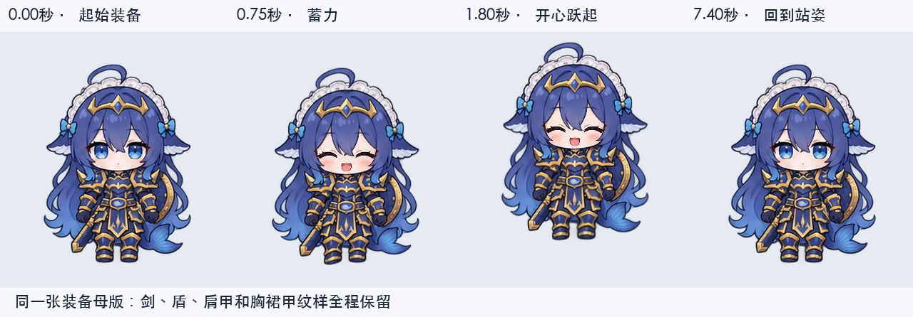

# 大肥鱼 × 经典八职业 v0.3.2

可重建的 AIRI 大肥鱼动作资产源包。八职业各有 114 个原版动作名对应的换装重制和 6 个新增动作，共 960 段 **640×360、60 fps、透明 VP9 WebM**。

**v0.3.2 的修复范围是战士 `开心蹦跳` 这一段。** 八份 manifest 统一使用 v0.3.2 标识；实际仅替换这一段媒体，其余 959 段沿用上一版。本轮没有完成其它职业或其它动作的装备一致性验收。

[修复后的战士蹦跳预览](preview/happy-jump.mp4) · [v0.3.1 插帧对比（历史）](preview/continuity-comparison.mp4) · [导入说明](IMPORT.txt) · [来源与许可](ATTRIBUTION.txt)



| 目录 | 职业 | 经典装备外观参考 |
| --- | --- | --- |
| `warrior` | 战士 | 愤怒 |
| `hunter` | 猎人 | 巨龙追猎者 |
| `mage` | 法师 | 灵风 |
| `rogue` | 盗贼 | 血牙 |
| `paladin` | 圣骑士 | 审判 |
| `warlock` | 术士 | 复仇 |
| `priest` | 牧师 | 卓越 |
| `druid` | 德鲁伊 | 怒风 |

本目录提交 144 张姿态图集、128 张基础关键帧、1 张新增表情参考图，共 273 张 PNG，以及提示词、八份 manifest 和制作工具。完整 960 段视频约 2.43 GB，由工具生成到忽略的 `build/` 目录，不随 Git 提交。完整可导入 ZIP 也在本地生成，不进入 Git。`manifests/` 只有配置，不能单独作为完整角色包导入。

## 战士蹦跳修复

v0.3.1 的战士蹦跳将带剑盾的基准站姿与装备细节不同的跳跃图集混合，导致盾牌消失、长剑缩短、肩甲和胸裙甲换形；部分补间还有护腕残影。此前的流畅度、文件完整性与导入检查遗漏了装备一致性，不能把那些检查解释成视觉验收通过。

v0.3.2 对这段动作改用固定母版：

- 身体、剑盾、肩甲和其它装备始终采样 `source/base-keyframes/warrior/frame-00.png` 的同一套纹理，以连续的二维网格运动表现蓄力、起跳和落地。
- 新增 `source/expressions/warrior/happy-face.png` 闭眼笑参考；生成图只在配置限定的脸内区域参与合成，装备不使用生成图中的替代画法。
- 不再在原站姿与旧的 16 张战士蹦跳图之间做光流换形。旧图集保留供来源追溯，并不代表它通过了本轮装备验收。

动作幅度采用克制的二维形变；这不是完整的三维骨骼动画，也不表示网格中每个关节都经过解剖学验证。专项检查的具体覆盖与结论见 [v0.3.2 装备一致性记录](verification/equipment-identity-v032.json)。

## 动作接口与其它媒体

新增动作是 `害怕`、`害羞`、`难过（眼睛饱含泪水）`、`想去玩（期待星星眼）`、`大哭`、`开心蹦跳`，均进入已有 `categories.情绪` 接口。原 114 个动作名、权重、事件和移动参数保留，包括原版 `小幅度原地360度旋转展示`；没有修改 AIRI 的自动 emotion 路由或应用运行设置。manifest 的严格 schema 仍为 `version: 1`，与资源包的 v0.3.2 版本标识分开。

其余 959 段继续使用上一版关键姿态、光流补间或跨形态叠化。v0.3.1 已移除补间中点硬切及侧跑收尾急变，但这些修复不保证装备设计一致，也不排除局部手臂、腿部、脸部和头发的重影、软化或形变。本版不声称对原视频逐帧换装，未在用户当前 AIRI Electron 窗口完成实播验收。

## 安装与重建

需要 Python 3.13、Node.js 24+，以及 PATH 中带 `libvpx-vp9` 的 FFmpeg 和 ffprobe。PNG 已提交，重编码不调用 image_gen，也不需要图像生成 API 密钥。以下命令在本目录运行；Python 虚拟环境激活方式按系统选择。

```sh
python3 -m venv .venv
# macOS / Linux: source .venv/bin/activate
# Windows PowerShell: .venv\Scripts\Activate.ps1
python -m pip install -r tools/requirements.txt
npm ci --ignore-scripts
python tools/verify-source.py
npm test
python -m unittest discover -s tools -p 'test_*.py'
```

先重建战士蹦跳和侧跑，检查新的动作分支与保留的制作链：

```sh
python tools/render.py --class warrior --action 开心蹦跳 --action 原地左转奔跑 --output build/smoke --workers 2
```

该命令只生成两段视频，不能作为完整包导入。完整重建：

```sh
python tools/render.py --workers 2
npm run validate -- --packs build/packs
npm run smoke:import -- --packs build/packs
python tools/package.py --packs build/packs --output dist
```

也可使用 `--class warrior` 只重建一个职业；`--output` 可指定独立输出目录。完整职业成功后才会写入 `pack.json`。渲染会复用源图、参数和工具指纹均匹配的已有结果，依赖或来源改变时重新生成。全量编码需要较长时间，并需预留源文件、约 2.43 GB 媒体及打包副本的磁盘空间。

打包工具只读输入，写同目录临时 ZIP、检查 CRC 后原子发布。已有输出默认拒绝覆盖，需显式传 `--overwrite`；它不会删除任何旧交付包。可先运行 `--verify-only`，或用 `--class warrior` 只打包一个职业。

## 导入

完整重建后可直接在 AIRI 大肥鱼资源包入口选择 `build/packs/<职业>`。若使用 ZIP，先解压，再选择其中含 `pack.json` 和 120 个 WebM 的职业目录，角色包名称含 `120动作 60fps v0.3.2`。目标是本仓库的大肥鱼导入器，不是 Spine / Live2D 的 ZIP loader。

## 验证与可复建边界

`tools/upstream/` 保存提交 `e3ddb35f8bf692c4fe3f8284caae9f4e4d526790` 的六个未修改接口文件与许可证，验证前先核对其 SHA256。Node 工具不依赖整个 AIRI 应用的安装或本机用户 profile。

- `verify-source.py`：保留 144 张图集和 128 张基础帧的完整校验，并检查新增表情 PNG 的索引、哈希、路径和文件集合。
- `npm test`：schema、原 114 动作契约、六个新增动作、八份版本标识，以及路径和写入边界。
- Python 测试：源图索引的遗漏、篡改、重复与路径边界，以及打包 CRC、版本一致性和原子发布行为。
- `npm run validate`：完整文件集、大小限制、VP9、60 fps、尺寸和 alpha 元数据。
- `npm run smoke:import`：原生导入器实际复制、媒体哈希、选择持久化、未列出资源拒绝和临时 profile 清理。
- 渲染与装备专项记录：输出解码、透明通道、运动方法、装备图源及实际视觉审查范围；文件元数据检查不替代逐帧视觉验收。

当前交付哈希见 `source/media-index.json`。对照该交付可在验证、原生导入或打包时追加 `--release-hashes`。重建的 WebM 容器可能有不同 TrackUID，FFmpeg 或平台版本也可能改变编码结果，因此普通重建不要求文件哈希逐字节等同。

[当前媒体检查](verification/media.json) · [当前原生导入记录](verification/native.json) · [v0.3.2 装备一致性记录](verification/equipment-identity-v032.json)

[v0.3.1 可移植渲染检查](verification/history/portable-render-smoke-v031.json) 与 [原始交付摘要](verification/original-release-summary.json) 是历史记录。旧渲染检查只证明当时重建结果与当时交付相同，没有检查出装备变化，不能用于证明本版视觉正确或替代本轮专项检查。

## 文件来源

原始角色来源、署名和许可范围见 [ATTRIBUTION.txt](ATTRIBUTION.txt)。关键姿态和新增表情参考由内置 image_gen 生成，提示词保存在 `source/prompts/`，图源记录在 `source/provenance/`。原有 PNG 保留不变；提帧边界修正在 `source/extraction-crops.json` 中记录。Warcraft 装备为同人视觉参考，没有导出游戏模型或贴图。

“可重建”指使用已提交 PNG 与动作配置重新编码；不表示重新调用图像生成服务能得到同一图像。
