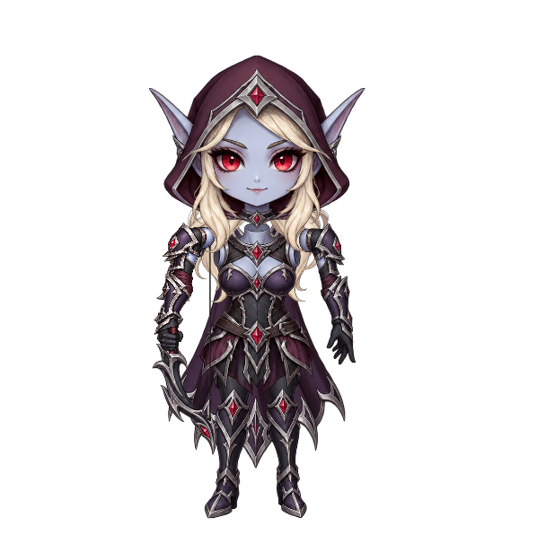

# 希尔瓦娜斯卡通陪伴形象 v0.3

可手动导入 AIRI 的 Spine 4.2 角色包，包含 12 根骨骼、9 个网格、2 张贴图和 19 个动作。

[下载导入 ZIP](output/sylvanas-companion.spine.zip) · [全身立绘](output/portrait.png) · [握弓近景](output/grip-closeup-idle.png)



v0.3 使用闭合持弓手，按贴图中的拳心和弓柄中心对齐。手指覆盖握柄，弓与手共同跟随前臂运动。预览提供“握弓近景”，可以检查动作中的接触关系。

## 导入 AIRI

1. 下载 `output/sylvanas-companion.spine.zip`，保持 ZIP 完整。
2. 在 AIRI 设置 → 模型 → 模型选择器中选择 Spine，导入 ZIP。
3. 选择该角色，皮肤使用 `default`，待机动作使用 `idle`。
4. 建议动画速度 1.0、混合时长 0.2–0.3 秒、最高帧率 60。

本次只新增资产和制作工具，不修改默认角色、模型预设或应用运行设置。

### 透明混合模式

两张 PNG 使用 straight alpha，atlas 页面均标为 `pma: false`。本仓库当前 AIRI 默认使用 premultiplied alpha，模型设置页没有对应开关。

首次接入时，在 AIRI 渲染窗口开发者工具控制台执行，然后重启 AIRI：

```js
localStorage.setItem('settings/spine/premultiplied-alpha', 'false')
```

这是该设备的全局 Spine 设置。以后切换到预乘 alpha 模型时，需要恢复相应设置。此资产提交不会自动更改它。

## 本地预览与重建

需要 Node.js 22+、pnpm 11 和 Python 3。首次克隆后，从仓库根目录执行：

```powershell
cd assets/sylvanas-companion
pnpm install --frozen-lockfile --ignore-scripts
pnpm build
pnpm validate
pnpm validate:airi
pnpm preview:bundle
python tools/serve-preview.py
```

打开 <http://127.0.0.1:8766/preview/>。服务器只监听本机地址。预览提供动作切换、自动陪伴、握弓近景、暂停、逐帧检查、速度调节、立绘导出和录像。

`pnpm build` 生成散装 JSON、atlas、PNG 和导入 ZIP。预览 bundle、依赖、录像以及散装输出不提交到 Git；导入 ZIP、审阅 PNG 和验证报告保留在仓库中。

自动陪伴调度属于本地预览。导入 AIRI 后，额外互动动作需要由应用事件触发。尚未在完整 AIRI Electron 应用中完成端到端导入验收。

## 动作

| 动作名 | 用途 |
| --- | --- |
| idle | 5 秒循环呼吸、轻摆、披风和发梢变形 |
| greet / wave | 招呼 / 挥手 |
| look-around / listen | 环顾 / 聆听 |
| nod / head-shake | 点头 / 摇头 |
| salute / stretch | 致意 / 舒展 |
| ready / bounce | 警戒 / 轻跳 |
| celebrate | 开心、庆祝 |
| sad / angry | 失落 / 生气 |
| think / question / curious | 思考 / 疑问 / 好奇 |
| surprise / awkward | 惊讶 / 害羞 |

AIRI 情绪映射：`happy → celebrate`，`surprised → surprise`，`neutral → idle`。眼睛和嘴仍在头部贴图内，没有独立眨眼、口型、面捕或 3D 转身；情绪通过身体姿态表达。

## 制作源文件

- `source/sylvanas-atlas.png`：原始分件图集，1254 × 1254。
- `source/arm-right-grip-clean.png`：闭合持弓右臂，1024 × 1536。
- `source/prompt*.txt`：内置 image_gen 的原始生成与修正提示词。
- `source/atlas-regions.json`：两张贴图的区域和网格轮廓。
- `source/rig-layout.json`：尺寸、枢轴、骨骼关系和真实握点 UV。
- `source/grip-landmarks.json`：人工定位的肩、肘、拳心像素坐标及弓柄 UV。
- `tools/build-rig.mjs`：构建骨骼、动画、图集和 ZIP。
- `tools/validate-rig.mjs`：检查格式、网格、动作、握持关系和 ZIP。
- `tools/check-airi-loader.mjs`：直接编译本仓库的 AIRI ZIP loader，验证两张贴图均可解析。

正常重建只使用已保存的网格数据，无需 Python 图像库。如果修改握弓手贴图或标记点，先安装 Pillow、NumPy，再执行 `python tools/prepare-grip-region.py` 更新右臂网格，随后重新构建和验证。

原图集保持不变。构建只复制 PNG；轮廓分析只读取 alpha 并生成网格，不改写图像像素。

## 验证记录

- Spine 4.2.120 解析、图集边界、源 PNG 哈希和 ZIP 完整性通过。
- 11,228 帧动作与双轨混合采样通过，握点最大偏差约 0.000023 模型单位。
- 握点按实际渲染网格三角形插值计算，不用骨骼原点代替手掌接触位置。
- 禁止弓相对闭合持弓手独立运动，动作首尾恢复，待机循环闭合。
- 已目视检查待机、警戒的握弓近景及舒展全身姿态。
- AIRI ZIP loader 检查记录包含本仓库 loader 源码和资产包的 SHA-256。

详细数据见 [动画验证报告](output/validation-report.json) 和 [AIRI loader 报告](output/airi-loader-report.json)。后一项只验证资源加载，不代表完整桌面应用验收。

## 来源与许可范围

图像由内置 image_gen 生成，骨骼和动画由本目录脚本编写。没有下载第三方希尔瓦娜斯模型，也没有提取暴雪游戏模型或贴图。希尔瓦娜斯 / Warcraft 角色和标识属于其原权利方，本资产为同人制作。

Spine 运行库是独立依赖，适用 [Spine Runtimes License](preview/SPINE-RUNTIME-LICENSE.txt)。导入 ZIP 只包含角色数据和贴图，不包含运行库。该运行库许可不代表角色图像、整个资产包或本目录脚本采用 MIT 许可；本目录未额外声明独立的复用许可。
