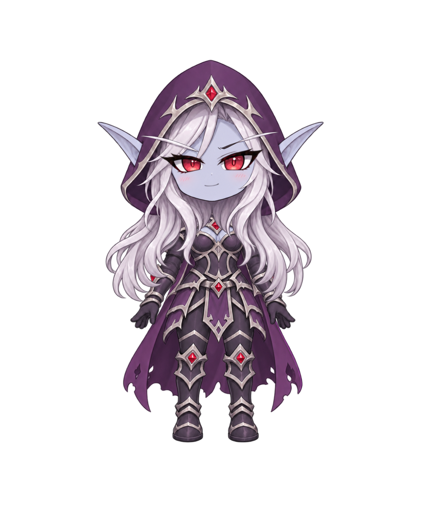

# 希尔瓦娜斯 Q 版 Live2D 桌宠 v2

v2 增加鼠标视线跟随、内置普通眨眼和打哈欠，并保留循环呼吸与说话口型。模型已由 Cubism Editor 真实导出，六项参数与浏览器动作检查通过。

[下载 v2 运行包](output/sylvanas-chibi-v2.live2d.zip) · [v2 Cubism 源工程](source/sylvanas-layers-v2.cmo3) · [分层 PSD](source/sylvanas-layers-v1.psd) · [模型预览](output/v2/preview.png) · [视线与哈欠视频](output/v2/browser-validation/gaze-and-yawn.webm)

## 导入 AIRI

1. 下载 `output/sylvanas-chibi-v2.live2d.zip`，保持 ZIP 完整。
2. 打开“设置 → 模型 → 选择模型 → 导入 → Live2D”，选择 ZIP。
3. 点击新增的 v2 模型卡片应用，开启“启用鼠标跟踪”、待机动画和“启用眨眼”。
4. 将“眨眼模式”设为“自动”，空闲动画选择本包的 `Idle`。
5. 移动鼠标检查视线，等待约 35 秒观察打哈欠。

v2 模型包需要重新导入并选中，旧模型卡片不会自动变成 v2。`Idle` 每 48 秒循环一次，保持四秒呼吸周期，内置六次普通眨眼，在第 35–40.2 秒打哈欠。

常态选择 `Idle`。`Yawn` 是 5.2 秒非循环动作文件，但空闲动画选择器会反复重播所选动作，因此不把它设为长期待机。

已有安装版应用可用“自动”模式保留本包的眨眼和哈欠。旧版“强制”模式会覆盖哈欠闭眼，需要更新应用代码后才能正确叠加。

视线方向跟随来自模型的新绑定。旧应用已有粗略方向驱动，本轮应用修复进一步改善中心与近中心的平滑归中；更新 ZIP 不会更新已安装应用代码，详情见[应用驱动检查](output/v2/application-validation.md)。

说话口型使用 `ParamMouthOpenY`。本轮未执行实际语音时序、完整桌面应用的设置页导入或重启持久化测试。

## 当前模型能力

| 参数 | 实际绑定 |
| --- | --- |
| `ParamEyeLOpen` / `ParamEyeROpen` | 0–1，分别控制左右眼。0 时将原眼睛网格垂直压细，1 时睁眼 |
| `ParamEyeBallX` / `ParamEyeBallY` | -1–1，双眼内部区域产生水平与垂直的小幅局部形变，响应鼠标方向 |
| `ParamMouthOpenY` | 0–1，闭嘴层与张嘴层切换；v2 最大开口改窄并增高，供哈欠与说话使用 |
| `ParamBreath` | 0–1，1 时身体网格放大至 101%，由动作中的四秒周期驱动 |

模型采用 SDK 5.0 导出设置，包含 7 个 Drawable 和一张 2048 × 2048 贴图。模型设置已配置 `EyeBlink` 与 `LipSync` 参数组。

`Idle` 同时控制呼吸、普通眨眼与哈欠，视线参数留给实时鼠标驱动。单次哈欠在 4.8 秒恢复闭嘴和睁眼，再保持到 5.2 秒结束，避免 SDK 淡出后残留微张嘴。

口型为基础两层方案：0 时闭嘴层不透明度为 100%、张嘴层为 0%。从 0.01 起，闭嘴层隐藏，张嘴层显示；张嘴层在 0.01 为略上移的扁平形，至 1 逐渐张开。

默认的 27 个参数仍保留，本版有上述 6 个参数绑定实际变化。转头、头发与披风物理、独立眉毛和额外表情尚未制作。

本版复用七层原画，通过双眼内部网格点制作局部视线关键形，没有新增独立眼白或虹膜图层。头发与兜帽仍合在 `Head`，四肢合在 `Body`。精细眼部拆层和弧形闭眼轮廓属于后续制作目标。

## 已确认设定

- 角色：希尔瓦娜斯，经典黑暗游侠造型。
- 外观：紫色兜帽、银发、灰蓝肤色、红瞳。
- 比例：约 2.5 头身。
- 气质：冷傲中带一点傲娇，适合日常桌面陪伴。
- 最终格式：Live2D，保留可编辑源文件，交付 AIRI 可导入的模型包。

## 文件与制作来源

视觉参考为[第二版透明全身原画](source/concept-v2.png)。七层 PSD 分别保存后披风、身体、头部、左右眼、闭嘴和张嘴，张嘴层默认隐藏。

| 文件 | 内容 |
| --- | --- |
| [output/sylvanas-chibi-v2.live2d.zip](output/sylvanas-chibi-v2.live2d.zip) | 当前 AIRI 导入包，包含真实 MOC3、贴图、模型设置与 Idle/Yawn 动作 |
| [output/v2/preview.png](output/v2/preview.png) | v2 运行模型的实际渲染预览 |
| [视线与哈欠视频](output/v2/browser-validation/gaze-and-yawn.webm) | 浏览器画布录制，展示鼠标九方向视线与一次哈欠 |
| [动作查看页](output/v2/browser-validation/motion-preview.html) | 视频、视线对照与哈欠时间点截图 |
| `source/concept-v2.png` | 当前全身视觉参考，1143 × 1376，RGBA 透明背景 |
| `source/concept-v1.png` | 首版参考，保留用于比较 |
| `source/prompt-concept-v1.txt` | 内置 image_gen 的首版生成提示词 |
| `source/prompt-concept-v2.txt` | 内置 image_gen 的构图修正提示词 |
| [source/layers/README.md](source/layers/README.md) | 内置 image_gen 制作的七张独立透明部件及完整提示词 |
| [source/sylvanas-layers-v1.psd](source/sylvanas-layers-v1.psd) | 七层可编辑 PSD，张嘴层默认隐藏 |
| [source/sylvanas-layers-v2.cmo3](source/sylvanas-layers-v2.cmo3) | Cubism Editor 5.3.04 保存的视线、眼口与呼吸绑定源工程 |
| `source/sylvanas-layers-v1.validation.json` | PSD 读回后的图层、可见性与逐字节像素验证 |
| `tools/pack-psd.py` | 只封装 PSD 容器，保留全部源 PNG 像素 |
| [tools/assemble-runtime-usage.md](tools/assemble-runtime-usage.md) | 从真实 Editor 导出文件组装运行包 |
| [tools/validate-runtime-usage.md](tools/validate-runtime-usage.md) | 使用显式传入的 Cubism Core 检查模型与参数 |
| [production-guide.md](production-guide.md) | 拆层、建模、导出与项目导入说明 |
| [editor-worklog.md](editor-worklog.md) | 本机编辑器操作与导出链路记录 |
| [image-validation.json](image-validation.json) | PNG 尺寸、透明通道、内容边界和 SHA-256 |

本次图像均由内置 image_gen 制作。PSD 工具只封装文件容器，没有裁切、缩放或重绘源 PNG。网格、关键形和 `.moc3` 来自真实 Cubism Editor 工程与导出。

组装工具保留 Editor 导出的 MOC3、贴图和 CDI 原始字节，只调整运行副本的模型设置并新增合法动作 JSON。动作使用脚本编写的曲线，不替代网格、关键形或 MOC3 导出。

## 验收记录

当前状态：v2 已真实导出，六项 Core 参数与浏览器动作检查通过。

| 记录 | 范围 |
| --- | --- |
| [v2 组装报告](output/v2/assembly-report.json) | 包内引用、ZIP 完整性及 Editor 原始资源的字节保留通过 |
| [v2 Core 检查](output/v2/core-validation.json) | Core 5.0.0 解析与六项参数的绘制数据变化通过 |
| [v2 浏览器检查](output/v2/browser-validation/report.json) | 六参数、28 个参数组合、11 个指针位置、精确闭嘴与完整 48 秒 Idle 通过，浏览器错误为空 |
| [应用驱动检查](output/v2/application-validation.md) | 中心归中、强制眨眼修复及定向回归结果，另记录受依赖阻碍的检查 |
| [PSD 校验](source/sylvanas-layers-v1.validation.json) | 图层名称、顺序、位置、可见性与 RGBA 像素读回 |
| [图像校验](image-validation.json) | 原画透明通道、内容边界与文件 SHA-256 |

完整 Idle 检查实际运行本轮的生产强制眨眼插件，确认其保留哈欠闭眼。单次 Yawn 结束时嘴参数为 0，闭嘴层显示、张嘴层隐藏。

项目类型检查、关联回归和 lint 仍受现有工具或依赖缺失阻碍，结果见应用驱动检查。本轮未完成完整 Electron 应用、全局鼠标输入或实际语音时序验收。

## v1 历史文件

[v1 运行包](output/sylvanas-chibi-v1.live2d.zip)、[v1 源工程](source/sylvanas-layers-v1.cmo3)、[v1 预览](output/preview.png)及[原验收报告](output/preview-fix-validation.md)保留原样。

v1 只绑定左右眼开闭、嘴开闭与呼吸，不含鼠标视线或哈欠。本页新增功能的验收以 v2 报告为准。

## 后续制作

精细拆分眼部、头发、兜帽和四肢后，再改进视线与闭眼轮廓，制作转头、物理摆动与额外表情。当前版本不包含这些高级绑定。

需要变更服装、比例、武器或新增互动动作时，先与用户确认。

希尔瓦娜斯与 Warcraft 为原权利方的角色和标识。本目录为同人创作，未使用提取的游戏模型或贴图。
